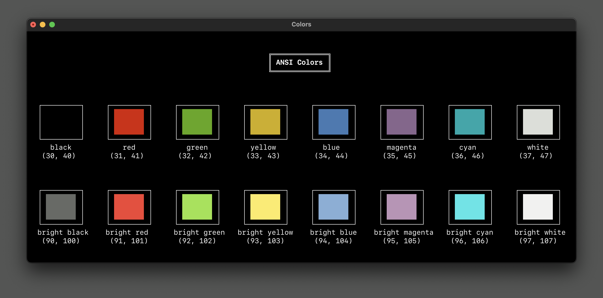
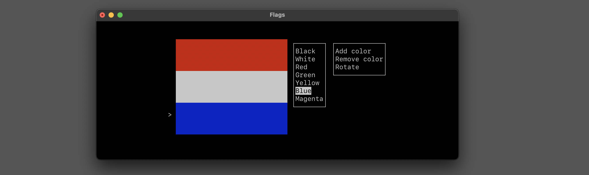
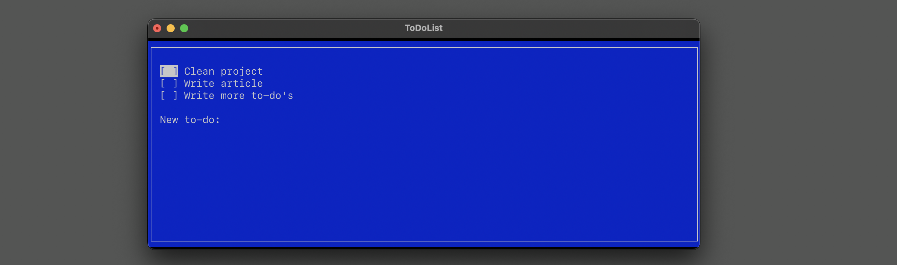

# KeelTUI

KeelTUI is a general-purpose terminal user interface toolkit for Swift applications on macOS 26 and later. It provides a declarative, SwiftUI-inspired API together with reusable lower-level terminal primitives.

The installation example targets KeelTUI **0.3.0**. The scrolling section also
documents the content-spacing API in this checkout.

## Requirements

- macOS 26 or later
- Swift 6.3 or later, using Swift 6 language mode

## Features

- Declarative view composition with `View`, `@ViewBuilder`, stacks, groups, conditionals, and collections
- State management with `@State`, `@Binding`, `@Environment`, and `@ObservedObject`
- Layout with frames, padding, alignment, spacers, dividers, and geometry readers
- Interactive controls including buttons, text fields, focus movement, and scrolling
- ANSI, xterm, and TrueColor output, plus text and border styling
- Terminal canvas and plain-text or ANSI snapshots
- Unicode-aware display-width handling
- Keyboard decoding, focus coordination, selectable lists, and text viewports
- Shared scroll ranges, viewport-sized movement, and configurable scrollbars with stable gutters and content spacing
- Tables, panes, modals, status bars, and terminal lifecycle management

## Getting started

Add KeelTUI to an executable Swift package with the following `Package.swift`:

```swift
// swift-tools-version: 6.3

import PackageDescription

let package = Package(
    name: "MyTerminalApp",
    platforms: [
        .macOS(.v26)
    ],
    dependencies: [
        .package(
            url: "https://github.com/uchimanajet7/keel-tui",
            from: "0.3.0"
        )
    ],
    targets: [
        .executableTarget(
            name: "MyTerminalApp",
            dependencies: [
                .product(name: "KeelTUI", package: "keel-tui")
            ]
        )
    ]
)
```

Import the module and start an `Application` with a root view:

```swift
import KeelTUI

struct MyTerminalView: View {
    var body: some View {
        Text("Hello, world!")
    }
}

Application(rootView: MyTerminalView()).start()
```

Run the executable from a terminal emulator:

```bash
swift run
```

## Reusable terminal presentation primitives

`TerminalStatusBar` resolves complete items before it draws. It measures display cells for both outer padding and inter-item separators, shows full labels when they fit, then compacts lower-priority items, and finally omits lower-priority items. Larger `retentionPriority` values are retained longer; when priorities match, later items compact or disappear first. A shortcut, its separating space, and its selected label are always one indivisible item.

`TerminalTextLayout` wraps styled `Character` values without splitting extended grapheme clusters. It preserves explicit newlines and empty lines, carries segment styles across wraps, and supports a styled continuation indent. The `.wordBoundary` policy prefers whitespace boundaries and hard-wraps long tokens; it is deliberately a practical terminal policy rather than a complete Unicode line-breaking implementation. At width zero, each logical input line resolves to one empty output line. A continuation indent is truncated to reserve one content cell. If a single `Character` is wider than the available width, layout keeps it atomic and `TerminalCanvas` leaves it undrawn unless all of its cells fit.

`TerminalModal.layout(in:)` chooses the modal width, allocates the scrollbar gutter, wraps at the resulting content width, applies height bounds, and returns normalized viewport metadata. The renderer is stateless: the application owns key handling and uses `scroll(_:in:)` or moves the returned state to supply the next offset.

Define shortcuts once with `TerminalKeyBindingPresentation`, then adapt the same descriptors for a status bar and grouped help. Each consumer must explicitly choose whether disabled bindings are included.

```swift
let bindings = [
    TerminalKeyBindingPresentation(
        id: "refresh",
        shortcut: "r",
        description: "Refresh data",
        compactDescription: "Refresh",
        groupID: "general",
        groupTitle: "General",
        retentionPriority: 20
    ),
    TerminalKeyBindingPresentation(
        id: "quit",
        shortcut: "q",
        description: "Quit",
        groupID: "general",
        groupTitle: "General",
        retentionPriority: 100
    )
]

let status = TerminalStatusBar(
    items: bindings.statusBarItems(disabledVisibility: .exclude)
)
let helpLines = TerminalBindingHelp.lines(
    from: bindings,
    width: 40,
    disabledVisibility: .include
)
let help = TerminalModal(
    title: "Help",
    styledLines: helpLines,
    preferredWidth: 44,
    maximumHeight: 18
)
```

## Shared scrolling

`TerminalScrollState` owns normalized content/viewport lengths, offset, visible
range, and before/after flags. It supports unit and viewport-sized page movement,
endpoints, and range revelation. `TerminalScrollbar` supplies geometry and drawing
without choosing keys, focus, selection, or follow-the-end behavior.

Text viewports, selectable lists, modals, tables, and declarative `ScrollView` use
the shared calculations. Indicators appear on initial overflow, including in
unfocused panes. `visibility: .whenNeeded` / `.hidden` controls drawing;
`gutter: .automatic` / `.stable` controls reservation; `contentSpacing` sets the
blank display cells between content and the one-column bar. It defaults to **0**,
preserving existing widths and wrapping. The example explicitly chooses **1** to
show separation; this is optional, not a universal terminal convention.

A stable gutter reserves both spacing and the bar even when content fits or
visibility is hidden. An automatic gutter with `.whenNeeded` measures without
reservation first and reserves both only on overflow, then remeasures at the final
content width. Hidden automatic gutters reserve neither. Negative spacing acts as
zero; oversized spacing shrinks before content, without integer overflow. With a
reserved bar, widths 2 and 1 yield content widths 1 and 0, with no spacing. Zero
width or height draws nothing, and zero content width has an empty visible range.

```swift
var text = TerminalTextViewport(
    lines: ["A complete sentence.", "There is more below.", "日本語 and e\u{301}."],
    scrollbar: TerminalScrollbar(visibility: .whenNeeded, gutter: .stable, contentSpacing: 1)
)
let frame = TerminalFrame(column: 0, line: 0, width: 24, height: 2)
var canvas = TerminalCanvas(size: TerminalSize(width: 24, height: 2))
text.draw(on: &canvas, frame: frame)
text.handle(.pageDown, in: frame)
text.draw(on: &canvas, frame: frame)
```

Low-level callers use `TerminalScrollbar.layout(in:offset:measure:)` for the final
measurement width, then clip drawing to `layout.contentFrame` and call
`scrollbar.draw(on: &canvas, layout: layout)`. Its read-only `spacingFrame` and
`scrollbarFrame` share that calculation. Spacing is cleared with the normal surface
background, independently of selection. Pass `background:` for a custom canvas
surface. The existing `draw(on:frame:state:)` still draws only in the supplied bar
frame. See the guide below for a complete low-level example.

The same configuration works in the declarative API:

```swift
ScrollView(scrollbar: TerminalScrollbar(gutter: .stable, contentSpacing: 1)) {
    ForEach(1 ... 40, id: \.self) { index in
        Button("Item \(index)") { /* application action */ }
    }
}
```

See the [scrolling guide](Sources/KeelTUI/KeelTUI.docc/Scrolling.md) for units,
state ownership, layout order, low-level drawing and movement examples, zero-size
behavior, and API migration. Height-only text/list slicing now saves the normalized
offset and requires a mutable component; page movement uses the measured viewport.
Version 0.3.0 also changes `TerminalModalLayout` construction and makes its metadata
read-only. Review the guide's [migration notes](Sources/KeelTUI/KeelTUI.docc/Scrolling.md#migrating-from-020-to-030)
when upgrading from 0.2.0.

## API documentation

The [DocC catalog](Sources/KeelTUI/KeelTUI.docc) is the source for the generated
reference in [`docs/`](docs). Generate the reference for static hosting with:

```sh
swift package --allow-writing-to-directory ./docs \
    generate-documentation --target KeelTUI --output-path ./docs \
    --disable-indexing --transform-for-static-hosting --hosting-base-path keel-tui \
    --warnings-as-errors
```

If the selected Command Line Tools do not provide `docc`, prefix the command with
`DEVELOPER_DIR=/Applications/Xcode.app/Contents/Developer` to use an installed
Xcode toolchain.

This prepares static files; publishing them requires a separately configured web
host. For a local preview, run `swift package preview-documentation --target KeelTUI`
and open the URL printed by the command.

## Examples

The repository includes five executable example packages:

- [Colors](Examples/Colors)
- [Flags](Examples/Flags)
- [Numbers](Examples/Numbers)
- [ToDoList](Examples/ToDoList)
- [Scrolling](Examples/Scrolling): wrapped text, a selectable list, a table, and a modal sharing stable scrollbars; press `s` to compare spacing 0/1 and `1`/`2` to switch displays. Includes operation and resize checks.

Run an example with `swift run` from its directory. Run automated tests with
`swift test` from the repository root. If the selected Command Line Tools lack
XCTest, use an installed Xcode toolchain, for example
`DEVELOPER_DIR=/Applications/Xcode.app/Contents/Developer swift test`.

### Colors



### Flags



### ToDoList



Berth uses KeelTUI.

## Provenance

KeelTUI is derived from [rensbreur/SwiftTUI](https://github.com/rensbreur/SwiftTUI), licensed under the MIT License. The original SwiftTUI copyright and license notice are preserved.

[TUIkit](https://github.com/phranck/TUIkit) was consulted only as a feature, user-experience, and behavior reference. No TUIkit source code is included in KeelTUI.

See [LICENSE](LICENSE) and [NOTICE](NOTICE) for attribution and license details.

## Contributing

Contributions that improve KeelTUI as a reusable, general-purpose terminal UI toolkit are welcome.
